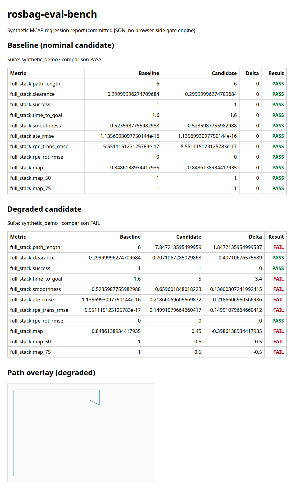

# rosbag-eval-bench

Offline regression evaluation bench for robot software by **Arpan Bom**. It reads **synthetic** ROS 2 MCAP logs, scores planning, localization, and detection against ground truth in the same bag, and writes HTML/Markdown/`results.json`. CI uses a **direction-aware** gate against a committed baseline (one-sided allowances; an improvement in the better direction does not fail). The nominal suite must exit 0; the degraded suite must exit 1 with FAIL on `full_stack.ate_rmse`, `full_stack.path_length`, and `full_stack.map`.

**Synthetic fixtures and simulation only.** This demo does not use real vehicle, farm, or customer bags. It does not claim Autoware compatibility, TIER IV `driving_log_replayer` production use, Lely hardware-in-the-loop testing, or certified functional-safety QA.

Licensed under the [Apache License 2.0](LICENSE).

## Demo



Published Pages app (when enabled): `https://applycoding.github.io/rosbag-eval-bench/`

## What it measures

- **Planning:** path length, polyline-to-occupied-**square** clearance (vertices and segments), success, `time_to_goal` from **path pose header stamps** (planned times, not live robot arrival), smoothness (rad/m).
- **Localization:** unaligned ATE (reported) and **aligned** `ate_rmse` (gated) via SE(2) Umeyama **estimate→GT** alignment; Sturm-style **time-based** RPE at Δt = 1 s (not KITTI distance-based relative error).
- **Detection:** precision/recall @ IoU 0.5 and **all-point interpolated AP** at COCO IoU thresholds — **not** official COCO 101-point AP.

Unknown occupancy cells (`-1`) are treated as passable in planning fixtures. MCAP metrics use integer `log_time_ns` only (not the wrapper’s `log_time` datetime).

## Quick start

Requirements: Python **3.12**, pinned stack in `requirements.lock.txt` (install with `pip install --require-hashes -r requirements.lock.txt`, then `pip install --no-deps -e .`). Lock file produced with **pip-tools 7.4.1** (`pip-compile --generate-hashes`).

```bash
reb --help
reb eval --suite fixtures/suite.yaml --baseline fixtures/baselines/suite.json --out reports/
pytest
```

Web UI (Node **26.13.0** + bundled npm **11.20.0**):

```bash
cd web && npm ci --legacy-peer-deps && npm run build
```

## Repository layout

See `PLAN.md` and `TASKS.md`. Committed synthetic bags (`fixtures/bags/`, seed `20261110`), baseline `fixtures/baselines/suite.json`, and Pages JSON under `fixtures/web/`.

## Honesty notes

- A **constant** pose offset is removed by rigid alignment and will **not** fail `ate_rmse`; the degraded fixture uses non-rigid drift.
- Clearance is centerline-to-occupied-square distance; `clearance == robot_radius` passes.
- `vision_msgs/Pose2D` uses nested `position.x` / `position.y` and `theta` (Humble 4.1.1).
- The optional ROS 2 Humble smoke job is a non-gating stub (`continue-on-error`). `tools/humble_smoke.py` does **not** install this package’s numpy 2.5 / Python 3.12 stack and does **not** open a bag.

## References

Idea-only references and licenses are listed in [REFERENCES.md](REFERENCES.md). Metric code is implemented from first principles. **evo** (GPL) and **pycocotools** are excluded from all dependency groups.

## License

Copyright 2026 Arpan Bom. Apache-2.0. See [NOTICE](NOTICE) for vendored messages and third-party notices.
